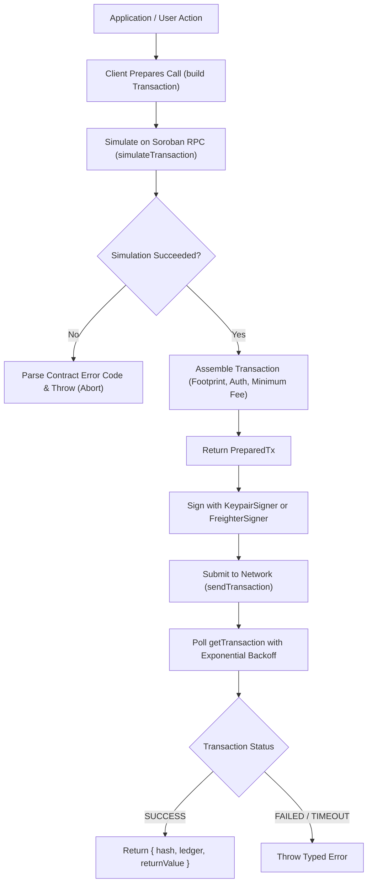

# @aether-swap/prince-sdk

[](https://github.com/Aether-Swap/prince-sdk/actions/workflows/ci.yml)
[](LICENSE)
[](#)

A strongly-typed TypeScript client SDK for the Very-Prince `PayoutRegistry` Soroban smart contract, enabling frontend applications and automated backend services to manage organizations, allocate multi-tranche vesting payouts, and claim funds on Stellar testnet without hand-assembling XDR.

> **Disclaimer**: Independent, community-built client. Not affiliated with or endorsed by the Stellar Development Foundation or the Very-Prince maintainers.

---

## Why This Exists

Interacting directly with Soroban smart contracts requires constructing low-level host invocation operations, manually assembling ledger footprint entries from simulation responses, decoding composite XDR data structures, and interpreting raw contract error codes like `Error(Contract, #24)`.

`@aether-swap/prince-sdk` solves this by providing:
- **Idiomatic TypeScript API**: Native camelCase methods mapping 1:1 with contract functionality.
- **Simulation-First Transaction Safety**: Write operations simulate on the RPC node before returning a prepared transaction. If simulation fails, execution halts before asking the user to sign.
- **Zero-Float Precision Arithmetic**: Pure `bigint` stroop calculations that prevent precision loss and reject negative values or overflows.
- **Vesting Pure Math**: High-level schedule generators with exact remainder distribution and binary-search milestone evaluation matching the contract's on-chain search algorithm.
- **Comprehensive Error Decoding**: All 46 contract error codes mapped to named JavaScript error classes.
- **Decoupled Signer Abstraction**: Private keys never touch client instances; signing works seamlessly with in-memory keypairs or the Freighter browser wallet.

---

## Status

**Alpha, testnet only.** This SDK targets the Very-Prince `PayoutRegistry` contract deployed on Stellar testnet. Mainnet deployment is explicitly out of scope.

---

## Installation

Install `@aether-swap/prince-sdk` along with the required peer dependency:

```bash
npm install @aether-swap/prince-sdk @stellar/stellar-sdk
```

### Optional Peer Dependencies

- **Freighter Browser Signer**: If using the browser extension wallet, install `@stellar/freighter-api`:
  ```bash
  npm install @stellar/freighter-api
  ```
- **React Hooks**: If using the `@aether-swap/prince-sdk/react` entrypoint, install `react`:
  ```bash
  npm install react
  ```

---

## Read a Claimable Balance (10 Lines)

```typescript
import { PayoutRegistryClient, fromSmallestUnit } from "@aether-swap/prince-sdk";

const client = new PayoutRegistryClient({
  contractId: "CA3D5KRYM6CB7OWQ6TWYRR3Z4T7GNZLKERYNZGGA5SOAOPIFY6YQGAXE",
  rpcUrl: "https://soroban-testnet.stellar.org",
});

const maintainer = "GA7QYNF7SOWQ3GLR2BGMZEHXAVIRZA4KVWLTJJFC7MGXUA74P7UJVWAC";
const balance = await client.getClaimableBalance(maintainer);
console.log(`Claimable: ${fromSmallestUnit(balance)} tokens (${balance} stroops)`);
```

---

## Full Example: Fund an Org and Claim a Payout with Freighter

```typescript
import {
  PayoutRegistryClient,
  FreighterSigner,
  toSmallestUnit,
  STELLAR_TESTNET_PASSPHRASE,
} from "@aether-swap/prince-sdk";

// Initialize client connected to Stellar Testnet
const client = new PayoutRegistryClient({
  contractId: "CA3D5KRYM6CB7OWQ6TWYRR3Z4T7GNZLKERYNZGGA5SOAOPIFY6YQGAXE",
  rpcUrl: "https://soroban-testnet.stellar.org",
  networkPassphrase: STELLAR_TESTNET_PASSPHRASE,
});

// Initialize browser wallet signer
const signer = new FreighterSigner();
const donorAddress = await signer.publicKey();

// Step 1: Fund the organization (simulates first, then prompts Freighter to sign)
const amountStroops = toSmallestUnit("250.0"); // 250 tokens in 7-decimal stroops
const preparedFund = await client.fundOrg({
  orgId: "aether_dao",
  from: donorAddress,
  amount: amountStroops,
});

console.log("Estimated Resource Fee:", preparedFund.simulation.fee);
const fundResult = await preparedFund.signAndSend(signer);
console.log(`Org funded in ledger ${fundResult.ledger}. Tx Hash: ${fundResult.hash}`);

// Step 2: Claim vested payout for connected wallet
const preparedClaim = await client.claimPayout({
  maintainer: donorAddress,
});

const claimResult = await preparedClaim.signAndSend(signer);
console.log(`Claimed ${claimResult.returnValue} stroops! Tx Hash: ${claimResult.hash}`);
```

---

## Signer Model

Private keys never touch `@aether-swap/prince-sdk`. The client relies on an abstract `Signer` interface:

```typescript
export interface Signer {
  publicKey(): Promise<string>;
  signTransaction(xdr: string, opts: { networkPassphrase: string }): Promise<string>;
}
```

Two concrete implementations are provided:
1. `KeypairSigner`: For server-side Node.js applications, automation scripts, and test suites. Supplied secret keys are used ephemerally to sign transaction envelopes and are never logged, stored, or exposed.
2. `FreighterSigner`: For browser frontends. Lazily imports `@stellar/freighter-api` to keep Node environments lean. Surfaces explicit errors for extension absence (`FreighterNotInstalledError`), user cancellation (`UserRejectedError`), and network divergence (`NetworkMismatchError`).

---

## Error Handling Guide

When a Soroban contract call or simulation fails, the SDK extracts the internal numeric error code and throws a corresponding named error class.

```typescript
import { PayoutRegistryClient, PayoutLockedError, OrgNotFoundError } from "@aether-swap/prince-sdk";

try {
  const prepared = await client.claimPayout({ maintainer: "G..." });
  await prepared.signAndSend(signer);
} catch (err) {
  if (err instanceof PayoutLockedError) {
    console.error("Payout is locked in a vesting schedule; unlock time not reached.");
  } else if (err instanceof OrgNotFoundError) {
    console.error("Organization ID does not exist in registry.");
  } else {
    console.error("Operation failed:", err);
  }
}
```

### Full Contract Error Mapping Table

| Code | Error Class | Description |
| --- | --- | --- |
| 1 | `AlreadyInitializedError` | The contract has already been initialized and cannot be re-configured. |
| 2 | `EmptyAdminListError` | The provided list of administrators for initialization is empty. |
| 3 | `InvalidThresholdError` | The native protocol admin config must contain exactly one admin with threshold 1. |
| 4 | `ContractNotInitializedError` | Attempted to call a function that requires the contract to be initialized. |
| 5 | `ProtocolPausedError` | The protocol is currently paused by the global administrators. |
| 6 | `InsufficientMultisigAuthError` | Legacy multisig signer payloads are no longer accepted. |
| 7 | `OrgAlreadyRegisteredError` | An organization with this ID already exists. |
| 8 | `OrgNotFoundError` | The requested organization could not be found in storage. |
| 9 | `NotAuthorizedError` | The caller does not have the necessary permissions for this operation. |
| 10 | `InvalidAmountError` | The amount provided must be a positive value. |
| 11 | `BudgetOverflowError` | The organization total budget would exceed the maximum representable value. |
| 12 | `InsufficientBudgetError` | The organization does not have enough remaining budget to cover the payout. |
| 13 | `MaxAdminLimitReachedError` | An organization cannot have more than 10 administrators. |
| 14 | `AdminAlreadyExistsError` | The address is already registered as an administrator for this organization. |
| 15 | `CannotRemoveLastAdminError` | Cannot remove the last administrator; an organization must have at least one. |
| 16 | `NotAnAdminError` | The address is not currently an administrator of the specified organization. |
| 17 | `MaintainerAlreadyRegisteredError` | This maintainer is already associated with an organization. |
| 18 | `MaintainerNotRegisteredError` | This maintainer is not registered in the system. |
| 19 | `MaintainerOrgMismatchError` | The maintainer is registered but belongs to a different organization. |
| 20 | `PayoutOverflowError` | The maintainer total claimable balance would exceed the maximum representable value. |
| 21 | `BatchSizeExceededError` | A batch payout operation cannot exceed 100 entries. |
| 22 | `EmptyBatchError` | The provided list of payouts for a batch operation is empty. |
| 23 | `NoClaimableBalanceError` | The maintainer has no funds available to claim. |
| 24 | `PayoutLockedError` | The payout is currently within its mandatory lock or vesting period. |
| 25 | `NoPendingAdminError` | There is no pending administrator proposal to accept. |
| 26 | `NotPendingAdminError` | The caller is not the address currently proposed as a new administrator. |
| 27 | `AmountExceedsLimitError` | The amount provided exceeds the maximum allowed limit ($10^{19}$ stroops). |
| 28 | `ReentrancyError` | Re-entrancy detected in contract execution. |
| 29 | `HumanityVerificationRequiredError` | A contributor must hold an active proof-of-humanity verification. |
| 30 | `QuadraticOverflowError` | Integer math overflowed while evaluating quadratic funding formula. |
| 31 | `EmptyMatchingPoolError` | The quadratic matching pool is empty. |
| 32 | `EmptyQuadraticRoundError` | The quadratic round has no positive project weight. |
| 33 | `DuplicateProjectError` | A project list cannot contain the same project more than once. |
| 34 | `InvalidNonceError` | The provided nonce does not match the expected next nonce for this caller. |
| 35 | `InvalidBlsSignatureError` | The BLS signature provided for the DAO approval is mathematically invalid. |
| 36 | `InvalidPoPError` | The BLS Proof-of-Possession provided during key registration is invalid. |
| 37 | `TokenMetadataUnavailableError` | Token metadata could not be fetched during initialization. |
| 38 | `FlashMintSupplyMismatchError` | Flash mint execution resulted in a non-zero supply delta. |
| 39 | `InvalidListInsertionPointError` | The provided insertion point for the sorted list is invalid. |
| 40 | `ListNodeNotFoundError` | The requested node was not found in the linked list. |
| 41 | `ListTraversalLimitExceededError` | The linked list traversal depth limit was reached. |
| 42 | `RoundingOverflowError` | Fixed-point vault conversion overflowed integer arithmetic. |
| 43 | `ZeroSharesMintedError` | A vault deposit rounded down to zero shares and was rejected. |
| 44 | `InsufficientShareBalanceError` | Caller attempted to burn more vault shares than their recorded balance. |
| 45 | `FlashLoanRepaymentFailedError` | The flash loan callback failed to return the borrowed amount plus fee. |
| 46 | `FlashLoanInsufficientLiquidityError` | The requested flash loan amount exceeds available liquidity. |
| * | `UnknownContractError` | Unmapped error code; retains numeric code as property. |

---

## Vesting Helpers

The `vesting` module provides pure utility functions matching the contract's tranche logic:

```typescript
import {
  linearSchedule,
  validateSchedule,
  vestedAt,
  validateAgainstExisting,
} from "@aether-swap/prince-sdk";

// 1. Generate an evenly distributed linear schedule with exact remainder handling
const schedule = linearSchedule({
  totalAmount: 100_000_000n, // 10 tokens
  startTime: 1700000000,
  endTime: 1700086400,
  tranchesCount: 4,
});

// 2. Validate schedule invariants (positive amounts, non-decreasing timestamps, sum check)
validateSchedule(schedule, 100_000_000n);

// 3. Compute vested amount at a specific timestamp via binary search
const vestedNow = vestedAt(schedule, 1700043200);
console.log("Vested at midpoint:", vestedNow);

// 4. Validate schedule continuity before appending new tranches to a maintainer
const existingTranches = [{ unlockTimestamp: 1700086400n, amount: 50_000_000n }];
validateAgainstExisting(schedule, existingTranches);
```

---

## Architecture Overview



---

## Testing Instructions

Run the complete test suite locally:

```bash
# Typecheck
npm run typecheck

# Lint source and test files
npm run lint

# Check code formatting
npm run format:check

# Compile dual ESM and CJS bundles
npm run build

# Run unit and property-based test suites
npm test

# Generate coverage report
npm run test:coverage
```

### Clean-Room Verification

To verify that the packaged tarball installs and works cleanly without local file leaks:

```bash
npm pack
mkdir -p /tmp/prince-sdk-verify
cp aether-swap-prince-sdk-*.tgz /tmp/prince-sdk-verify/
cd /tmp/prince-sdk-verify
npm init -y
npm install ./aether-swap-prince-sdk-*.tgz
node -e 'const sdk = require("@aether-swap/prince-sdk"); console.log("CJS load:", typeof sdk.PayoutRegistryClient);'
node --input-type=module -e 'import { PayoutRegistryClient } from "@aether-swap/prince-sdk"; console.log("ESM load:", typeof PayoutRegistryClient);'
rm -rf /tmp/prince-sdk-verify
```

---

## Contributing

Contributions are welcome! Please review [CONTRIBUTING.md](CONTRIBUTING.md) for local setup instructions and [CODE_OF_CONDUCT.md](CODE_OF_CONDUCT.md) for community standards.

---

## License

MIT License. Copyright (c) 2026 Alhaji-naira. See [LICENSE](LICENSE) for details.
