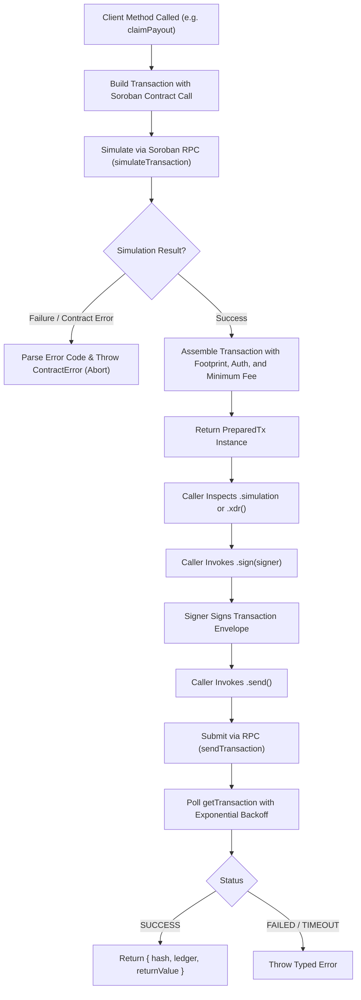

# Architecture & Technical Design

`@aether-swap/prince-sdk` is an independent, type-safe TypeScript client for the Very-Prince `PayoutRegistry` Soroban smart contract on Stellar testnet.

## High-Level Architecture

The SDK separates concern across eight dedicated subsystems:

```
┌─────────────────────────────────────────────────────────────┐
│                       Client Layer                          │
│                   (PayoutRegistryClient)                    │
└──────────────┬──────────────────────────────┬───────────────┘
               │                              │
       Read Operations                Write Operations
      (Simulation Only)               (Returns PreparedTx)
               │                              │
               ▼                              ▼
┌─────────────────────────────┐┌──────────────────────────────┐
│       Soroban RPC           ││        PreparedTx            │
│  simulateTransaction(...)   ││  .xdr() / .simulation        │
└──────────────┬──────────────┘└──────────────┬───────────────┘
               │                              │
               ▼                              ▼
┌─────────────────────────────┐┌──────────────────────────────┐
│     Result Deserializer     ││         Signer Layer         │
│  (scValToNative / Events)   ││ (KeypairSigner / Freighter)  │
└─────────────────────────────┘└──────────────┬───────────────┘
                                              │
                                              ▼
                               ┌──────────────────────────────┐
                               │       Execution / Poll       │
                               │  sendTransaction / Backoff   │
                               └──────────────────────────────┘
```

## Component Architecture

| Subsystem | Path | Purpose |
| --- | --- | --- |
| **Client** | `src/client.ts` | High-level facade exposing typed read queries and transaction preparation methods. |
| **Transaction Lifecycle** | `src/tx.ts` | `PreparedTx` abstraction managing simulation verification, fee estimation, signing, and polling. |
| **Signer Model** | `src/signers.ts` | Signer abstractions (`KeypairSigner`, `FreighterSigner`) ensuring secrets never touch client memory. |
| **Errors** | `src/errors.ts` | Comprehensive mapping for all 46 contract error codes, plus network, simulation, and RPC errors. |
| **Amounts** | `src/amounts.ts` | Decimal string to `bigint` stroop conversion enforcing `MAX_AMOUNT_LIMIT` with zero float operations. |
| **Vesting** | `src/vesting.ts` | Pure vesting math, exact remainder distribution, binary search evaluation, and schedule continuity checks. |
| **Events** | `src/events.ts` | Type-safe decoders for all in-scope contract events, preserving unknown events as raw objects. |
| **React Hooks** | `src/react/index.ts` | Thin state hooks for React applications (`usePayoutRegistry`, `useClaimableBalance`, `useClaimPayout`). |

---

## Transaction Lifecycle & Simulation-First Guarantee

The SDK strictly enforces a **simulation-first** guarantee: write methods simulate the transaction on the RPC node and verify execution before returning a `PreparedTx`. If simulation fails, a typed `ContractError` or `SimulationError` is thrown immediately, and **no signing is ever requested**.



---

## Precision Amounts & Zero-Float Arithmetic

All token amounts represent base stroops ($10^{-7}$ tokens) stored as native JavaScript `bigint`.

- Floats and scientific notation (`1e5`) are rejected up-front during string parsing.
- String conversion uses exact integer division and string padding (`padEnd` / `padStart`).
- Cumulative amounts and tranches are validated against `MAX_AMOUNT_LIMIT = 10_000_000_000_000_000_000n` ($10^{19}$ stroops).

---

## Schedule Continuity in Vesting

When `allocate_payout_vesting` is invoked on-chain, new tranches are appended directly to the maintainer's existing tranche vector. The contract uses an $O(\log N)$ binary search to evaluate vested amounts, which relies on the entire merged schedule being ordered monotonically by `unlock_timestamp`.

The SDK's `validateAgainstExisting` pure helper validates that the first milestone of any new schedule satisfies `unlockTimestamp >= lastExistingUnlockTimestamp`, ensuring seamless schedule continuity.
